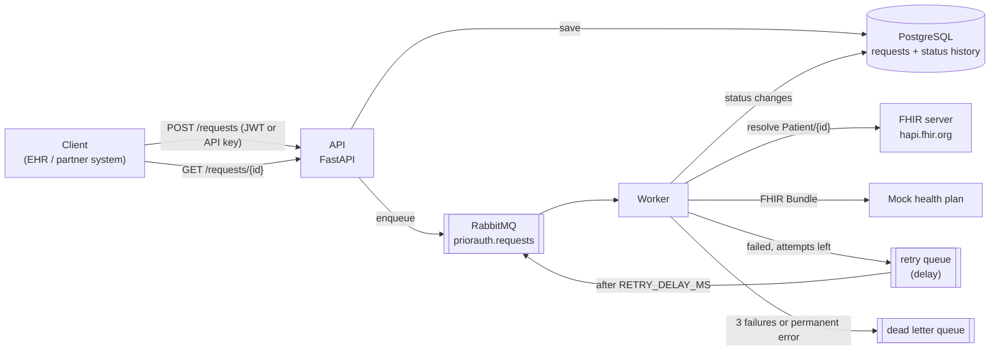

# PriorAuth Gateway

[](https://github.com/YOUR_GITHUB_USERNAME/priorauth-gateway/actions/workflows/ci.yml)

A small event-driven service that takes a FHIR-shaped prior authorization request, queues it, sends
it to a (mock) health plan, and lets you check the result. Python, FastAPI, PostgreSQL, RabbitMQ,
Docker, OpenTelemetry, Prometheus, Grafana, Terraform.

> **All data is fake.** The patients, subscribers and health plan are invented. Never send real
> patient information to this service.

## Why prior authorization needs integrations

Before some procedures (an MRI, a specialty drug), a provider has to get the patient's health plan
to approve it: *prior authorization*. Today that often means faxes, phone calls and payer portals,
and it delays care. Automating it means connecting systems that were never built to talk to each
other: an EHR on one side, many health plans with different APIs, speeds and outages on the other.
That needs a common data format (FHIR), and an integration layer that never loses a request when a
health plan is slow or down. This project is a small version of that layer.

## Architecture



The API saves each request and puts it on a queue, and a worker does the slow work, so a slow
health plan never blocks the API. The worker sends each request to the health plan, fetches FHIR
data when the request only references a patient, and writes every status change to PostgreSQL. A
request that fails three times goes to the dead letter queue (DLQ), where you can inspect it.

Statuses: `received` → `sent` → `approved` | `denied` | `failed`. Every change is a row in
`status_history`, with the attempt number and the error.

## Run it

Needs Docker with Compose.

```bash
cp .env.example .env
docker compose up --build
```

In another terminal, log in and submit the sample request:

```bash
TOKEN=$(curl -s -X POST localhost:8080/auth/token \
  -d username=clinician -d password=clinician-dev-pw | jq -r .access_token)

curl -s -X POST localhost:8080/requests \
  -H "Authorization: Bearer $TOKEN" -H "Content-Type: application/json" \
  -d @scripts/sample_request.json
# {"id":"8c1f...","status":"received","statusUrl":"/requests/8c1f..."}

curl -s localhost:8080/requests/<id> -H "Authorization: Bearer $TOKEN"
# {"status":"approved","authorizationNumber":"MOCK-1A2B3C4D", ...}

curl -s localhost:8080/requests/<id>/history -H "Authorization: Bearer $TOKEN"
```

| What              | URL                         |
| ----------------- | --------------------------- |
| API docs (Swagger, try it out) | http://localhost:8080/docs |
| Grafana dashboard | http://localhost:3000 (anonymous view; admin / `GRAFANA_ADMIN_PASSWORD`) |
| Jaeger traces     | http://localhost:16686      |
| RabbitMQ          | http://localhost:15672 (guest / guest) |
| Prometheus        | http://localhost:9090       |
| Mock health plan  | http://localhost:8081/docs  |

Dev logins (from `.env.example`): `clinician / clinician-dev-pw` (submitter),
`reviewer / reviewer-dev-pw` (viewer), `admin / admin-dev-pw` (admin), and the partner API key
`dev-partner-key-change-me` (send it as `X-API-Key`).

### Make it fail on purpose

The mock health plan reads the `coverage.subscriberId` prefix:

| subscriberId   | What happens                                                |
| -------------- | ----------------------------------------------------------- |
| `TIMEOUT-...`  | times out 3 times → `failed`, message in the DLQ            |
| `ERROR-...`    | HTTP 503 three times → `failed`, DLQ                        |
| `FLAKY-...`    | 503 twice, then approved on attempt 3                       |
| `BADREQ-...`   | HTTP 400: permanent, no retry → `failed`, DLQ               |

Or break the whole health plan: `docker compose stop mock-payer`, or
`curl -X POST localhost:8081/admin/failure-mode -H 'Content-Type: application/json' -d '{"mode":"timeout"}'`.

Inspect the DLQ as admin: `GET /admin/dlq`. Leave out `reasonCode` to get a `denied`.

### Use a real FHIR Patient

```bash
python scripts/fetch_fhir_patient.py
```

finds a Patient on the public HAPI test server, submits a request with
`"patientReference": "Patient/<id>"`, and the worker fetches that Patient before calling the health
plan. With no internet, set `FHIR_BASE_URL=http://mock-payer:8081/fhir` in `.env` and use
`Patient/fake-1001`.

## API

| Method | Path                         | Role                  | What it does                         |
| ------ | ---------------------------- | --------------------- | ------------------------------------ |
| POST   | `/auth/token`                | none                  | Log in, get a JWT                    |
| POST   | `/requests`                  | submitter             | Submit; returns 202 and a status URL |
| GET    | `/requests/{id}`             | submitter (own) or viewer | Current status and decision      |
| GET    | `/requests/{id}/history`     | submitter (own) or viewer | Every status change              |
| GET    | `/requests?status=&limit=`   | viewer                | Recent requests                      |
| GET    | `/admin/dlq`                 | admin                 | Peek at the dead letter queue        |
| GET    | `/metrics`, `/health/*`      | none                  | Prometheus metrics, health checks    |

Full reference: [`docs/openapi.json`](docs/openapi.json) (static page: [`docs/api.html`](docs/api.html)),
or Swagger UI at `/docs` while the stack runs. Invalid requests get a 422 with a FHIR
`OperationOutcome` naming each bad field.

## Tests

| Layer       | What it checks | Tool | Count |
| ----------- | -------------- | ---- | ----- |
| Unit        | Validation rules, status transitions, retry and DLQ decisions, auth and roles, HTTP clients, mock health plan, trace propagation. Database, queue and HTTP mocked. | pytest, `unittest.mock`, `httpx.MockTransport` | 105 |
| Integration | API, worker, Postgres and RabbitMQ together: approval, denial, **three timeouts → DLQ**, flaky recovery, permanent errors, FHIR lookup, duplicate and poison messages, DB constraints. | pytest + Testcontainers | 11 |
| End to end  | The running docker-compose stack through public endpoints only. | pytest + httpx | 6 |
| CI          | All of the above on every push, plus lint, the Docker image build and `terraform validate`. | GitHub Actions | |

```bash
pip install -r requirements-dev.txt
pytest tests/unit                          # no services needed
pytest -m integration tests/integration    # needs Docker (Testcontainers)
docker compose up -d && pytest -m e2e      # against the running stack
```

No Docker? Point the integration tests at existing services with `TEST_DATABASE_URL` and
`TEST_AMQP_URL` (they drop and recreate the tables and queues there).

## Observability

- **Logs:** JSON on stdout. Every line has `service`, `request_id`, `attempt` and `trace_id`, so one
  grep follows a request through the API and the worker.
- **Traces:** OpenTelemetry. The trace context travels in the AMQP message headers, so one trace
  covers API → queue → worker → health plan, across retries. View it in Jaeger.
- **Metrics:** Prometheus. Requests received, rejected and failed (by reason), decisions, health plan
  call outcomes and latency, retries, dead-lettered messages, API latency by route, and queue depth
  per queue from RabbitMQ's Prometheus plugin. One Grafana dashboard shows it all.

The [runbook](docs/RUNBOOK.md) walks through a failure I caused (stopping the health plan) and how
it shows up in the logs and the dashboard.

## Security

- JWT login with pinned algorithm, issuer, audience and expiry checks; API keys for partner systems,
  stored only as SHA-256 hashes and compared in constant time.
- A role check runs before every endpoint does anything. Submitters see only their own requests
  (and get 404, not 403, for others, so ids cannot be probed).
- Secrets come from environment variables. `.env` is git-ignored; `.env.example` holds only fake
  dev values. The service refuses to start without `JWT_SECRET`.
- The container runs as a non-root user. Only fake data, ever.

## Infrastructure as code

[`infra/terraform`](infra/terraform) describes the AWS version: ECS Fargate (API behind an ALB,
worker, mock health plan), RDS PostgreSQL, Amazon MQ for RabbitMQ, Secrets Manager, CloudWatch
Logs, and a VPC with private subnets. **It is validated (`terraform validate` in CI) but not
deployed.** See its README for what it would cost and what is missing.

## Project layout

```
src/priorauth/
  api/            FastAPI app, routes, response schemas
  worker/         queue consumer (main.py) and the processing logic (processor.py)
  clients/        health plan and FHIR server clients, with error classification and retries
  mock_payer/     the fake health plan
  fhir.py         FHIR-shaped resources and validation
  queue.py        RabbitMQ topology, publisher, DLQ peek
  models.py       tables; repository.py writes them; status.py is the state machine
  security.py     JWT, API keys, roles
  log.py, telemetry.py, metrics.py
migrations/       Alembic
tests/            unit / integration / e2e
docker/           Prometheus, Grafana and RabbitMQ config
infra/terraform/  AWS version
docs/             runbook, interview notes, OpenAPI
```

## What I would add next

- **Transactional outbox.** The API commits the row, then publishes. If the publish fails it marks
  the request `failed` and returns 503, but a crash between the two steps would leave a request
  stuck in `received`. An outbox table written in the same transaction, plus a relay, closes that gap.
- **DLQ replay.** An admin endpoint that resets a failed request and requeues it.
- **Exponential backoff.** Retries use one fixed delay. Several retry queues (1s, 5s, 30s) would back
  off without the head-of-line blocking that per-message TTLs cause in RabbitMQ.
- **Real FHIR prior auth.** The Da Vinci PAS `Claim` / `ClaimResponse` bundle instead of a simple
  Bundle, plus profile validation.
- **Real identity provider.** OIDC (Keycloak locally, Cognito in AWS) with RS256 instead of the demo
  token endpoint.
- **SQS adapter** for the queue, and an ADOT collector to send traces to X-Ray in AWS.
- **Webhooks** so partners do not have to poll.
- **Alerting rules** (DLQ above 0, decision rate at zero) instead of only a dashboard.

## License

MIT. Fake data only.
